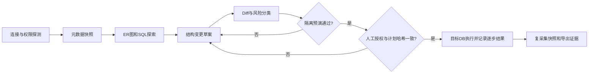

# 01 要件定义书

| 属性 | 值 |
|---|---|
| 产品 | PANTHEON：A5类数据库工作台 / AI原生增强版 |
| 文档版本 | 1.0.0（设计基线，未实施） |
| 基线日期 | 2026-11-03 |
| 语言 | 中文；中日术语对照；导出兼容日文设计书 |
| 状态 | **设计候选基线（待产品负责人和安全负责人正式批准）** |
| 适用工程 | IPA《共通フレーム2013》参考，需求→基本→详细→UT→IT→ST |

## 1. 项目背景与业务目标

日本数据库现场常将SQL操作、ER图、表定义书和测试证据分散在多个工具。PANTHEON目标是把**数据库实际结构**与**工程设计资料**、**安全变更**关联，实现一次操作、多种可追溯成果物。核心业务价值不是AI自动改库，而是缩短读库→理解→建模→审查→验证→交付的路径。

### 可验证的业务目标（上线后测量）

| 目标ID | 业务指标 | 基准测量方法 | 初期目标 |
|---|---|---|---|
| BR-01 | 新项目DB探索时间 | 5人对照实验：从连接到找到指定外键 | 中位数较当前工具缩短20%（待基线确认） |
| BR-02 | DB表定义书编制时间 | 100表结构样本人工核对 | 较手工编制缩短50%（待基线确认） |
| BR-03 | 生产DDL误操作率 | 模拟危险迁移/误审场景 | 100%通过指定安全阻断用例 |
| BR-04 | 设计与DB一致性 | 修改DB后快照/Diff校验 | 指定结构变化100%可定位 |
| BR-05 | AI数据最小化 | 抓包和本地日志扫描 | 未经同意零外传 |

## 2. 利益相关者与使用场景

| 角色 | 主要任务 | 权限或约束 |
|---|---|---|
| DB开发工程师 | SQL、表数据、ER、SQL历史 | 按DB账户实际权限 |
| DBA/架构师 | Schema设计、Diff、迁移、性能分析 | 生产变更执行另需审批 |
| QA/测试负责人 | 导出证据、异常案例、版本回归 | 默认只读和脱敏导出 |
| 业务设计人员 | 逻辑名、表定义书、ER批注 | 不直接修改生产物理库 |
| 安全/审计人员 | 审计、凭据、脱敏与AI共享控制 | 仅查看脱敏审计 |
| 系统管理员 | 分发安装包、升级、备份恢复 | 不自动获得DB权限 |

## 3. 业务范围、前提与排除项

- 本地优先桌面应用；P0无需在线账号或SaaS控制面。
- 产品不是DBMS/代理，不提供服务器端高可用、复制、生产备份执行服务。
- P0不支持多人实时协作、企业SSO、Oracle、自动执行AI SQL；这些作为后续路线候选。
- 数据库源凭据不进入云服务，上传模型元数据必须可预览且逐次授权。
- 产品不保证分析用户自写任意SQL全部风险：未知SQL按高风险、使用最小权限DB角色作为最终保护。
- 输出的设计书/ER使用快照关联及生成时间，不能替代变更管理审批。

## 4. 系统化业务流程（As-Is / To-Be）

**As-Is**：连接DB → 手动查表/编ER → Excel整理 → 人工比较DDL → 手工审查 → SQL执行 → 整理日志。

**To-Be**：连接DB → 自动采集快照 → ER与SQL联动 → 编辑逻辑/物理设计草稿 → 生成差异/可审查DDL → 测试库预演 → 人工审批 → 使用DB权限执行 → 输出审计和表定义书。

## 5. 功能需求清单（FR）

优先级Must/Should分别对应首发必须/扩展建议。P0属于发布门禁，P1不是P0准出的阻断项。每项均在Excel登记并追踪到测试。

## 5.1 工作区与连接

| 需求ID | 功能 | 规定行为 | 验收条件 | 优先级/阶段 |
| --- | --- | --- | --- | --- |
| FR-01-01 | 工作区创建与切换 | 工作区隔离连接、SQL文件、ER布局、历史和导出配置；路径可自定义。 | 新建后列出空工作区；切换不泄漏上个工作区状态。 | Must/P0 |
| FR-01-02 | 连接配置 | 创建PG/MySQL/SQLite/SQL Server连接；保存别名、主机、端口、库、TLS参数，密码分离到系统凭据库。 | 四种引擎建立有效连接；配置文件不含明文密码。 | Must/P0 |
| FR-01-03 | 连接测试与超时 | 连接测试具超时、重试和错误分类，支持取消；不自动执行任何变更。 | 超时10秒可中止；错误显示网络/认证/TLS等类别。 | Must/P0 |
| FR-01-04 | 只读安全模式 | 连接默认只读；写入需手动开启并显示环境、帐号、风险横幅。 | 只读角色不允许写入；仅切换UI不绕过数据库权限。 | Must/P0 |
| FR-01-05 | 对象资源树 | schema/table/view/index/procedure按引擎能力懒加载，支持搜索、刷新、权限不足提示。 | 1万对象检索不冻结主线程；无权限显示可恢复错误。 | Must/P0 |
| FR-01-06 | 多连接与标签 | 同时维护多个连接、多标签，标签绑定连接上下文。 | 两连接执行不会串库；关闭连接提示未保存编辑。 | Must/P0 |
| FR-01-07 | 环境标记 | 开发/测试/生产可自定义环境；生产默认写操作二次确认。 | 生产写操作显示目标主机/库/影响估计与确认。 | Must/P0 |

## 5.2 SQL编辑执行

| 需求ID | 功能 | 规定行为 | 验收条件 | 优先级/阶段 |
| --- | --- | --- | --- | --- |
| FR-02-01 | SQL语法编辑 | 按SQL方言高亮、自动补全、代码折叠、格式化及快捷键。 | 4种方言高亮/补全；非法SQL不导致编辑器崩溃。 | Must/P0 |
| FR-02-02 | 参数化查询 | 支持命名参数和驱动绑定；禁止拼接用户输入生成内部SQL。 | 带引号/特殊字符参数按原值绑定，无额外SQL生效。 | Must/P0 |
| FR-02-03 | 多语句切分 | 按方言切分语句并保留注释/字符串边界，未知语法进入高风险人工确认。 | 分号位于字符串/注释内时不错误切分。 | Must/P0 |
| FR-02-04 | 执行控制 | 运行当前语句/选中语句/全部；显示耗时、影响行、连接和事务状态。 | 执行与取消状态可观察；执行日志关联一次请求ID。 | Must/P0 |
| FR-02-05 | 取消与超时 | 允许取消查询并超时自动关闭游标；取消不假定事务回滚。 | 取消后标识事务状态不确定时阻断下一写请求。 | Must/P0 |
| FR-02-06 | 事务处理 | 支持手动BEGIN/COMMIT/ROLLBACK与默认自动提交选项，事务状态机随驱动对齐。 | 未提交变更关闭窗口必提示；断连显示未知状态。 | Must/P0 |
| FR-02-07 | 执行计划 | 支持目标数据库EXPLAIN适配，区分仅计划与实际执行。 | EXPLAIN ANALYZE等可能实际运行的模式显著警示。 | Must/P0 |
| FR-02-08 | SQL历史与收藏 | 历史仅本地保存可配置保留期，敏感字串脱敏；支持收藏和搜索。 | 保留期到期清理；不记录凭据、绑定敏感值。 | Must/P0 |
| FR-02-09 | SQL结果分页 | 按游标/键集或驱动支持策略流式分页，大小及超时可配置。 | 100万行不一次全量驻内存；取消可释放资源。 | Must/P0 |

## 5.3 数据浏览编辑

| 需求ID | 功能 | 规定行为 | 验收条件 | 优先级/阶段 |
| --- | --- | --- | --- | --- |
| FR-03-01 | 表结构查看 | 显示字段、类型、默认值、PK/FK/索引、注释及权限。 | PG/MySQL/SQLite/SQLServer字段映射正确；不可用特性标注。 | Must/P0 |
| FR-03-02 | 数据网格查看 | 支持过滤、排序、分页、复制及NULL/二进制显示。 | NULL与空字符串视觉区分；二进制按十六进制预览。 | Must/P0 |
| FR-03-03 | 行编辑 | 仅对具稳定唯一键的表允许编辑并生成参数化UPDATE。 | 无唯一键表默认不可编辑；影响行非1则回滚/报冲突。 | Must/P0 |
| FR-03-04 | 新增与删除 | INSERT/DELETE在写模式下才可用；删除需要确认及行条件检查。 | 生产删除始终二次确认；无PK时禁止单行删除。 | Must/P0 |
| FR-03-05 | 并发冲突检测 | 依据版本列或原值比较做乐观并发，冲突不覆盖他人修改。 | 并发更新导致影响0行，显示冲突并可刷新比较。 | Must/P0 |
| FR-03-06 | 筛选器安全构造 | 可视化条件生成经字段白名单及值绑定验证的SQL。 | 字段名严格从元数据选择；过滤输入不能改变SQL结构。 | Must/P0 |
| FR-03-07 | 大对象预览 | BLOB/CLOB按大小限制预览，下载须确认并避免内存峰值。 | 大于阈值只展示摘要；显式导出采用流式处理。 | Must/P0 |
| FR-03-08 | 变更预览与撤销 | 批量变更先显示行数/差异/风险，提交前可撤销本地草稿。 | 提交前撤销不发送SQL；提交后不虚称可撤销。 | Must/P0 |

## 5.4 ER建模

| 需求ID | 功能 | 规定行为 | 验收条件 | 优先级/阶段 |
| --- | --- | --- | --- | --- |
| FR-04-01 | 逆向生成ER | 从数据库元数据生成实体与FK关系，标记无FK推断为建议。 | 真实FK为实线；推断关系不误标为真实约束。 | Must/P0 |
| FR-04-02 | ER无限画布 | 缩放、平移、多选、框选、搜索、对齐、分组与保存位置。 | 1000表场景满足性能阈值；画布变更有撤销重做。 | Must/P0 |
| FR-04-03 | 双名称显示 | 字段逻辑名/物理名切换，并允许单独维护逻辑名称映射。 | 修改逻辑名不会直接修改物理库。 | Must/P0 |
| FR-04-04 | 关系检查 | 检测断裂FK、循环、重名、多重边及类型不一致，并给出证据。 | 每个告警指向对象和可复现结构，不自动改表。 | Must/P0 |
| FR-04-05 | ER正向建模 | 草拟表/列/关系的结构意图，仅生成可审查DDL，不直接执行。 | ER建模更改产生DDL预览和人工批准节点。 | Must/P0 |
| FR-04-06 | ER与SQL联动 | 单击节点打开表结构、DDL、数据和引用SQL；按连接隔离。 | 任何节点点击不跨连接串扰。 | Must/P0 |
| FR-04-07 | ER布局导入导出 | 布局按稳定对象ID存JSON，支持SVG/PNG导出及恢复。 | 布局恢复保留坐标；导出不包含密码。 | Must/P0 |
| FR-04-08 | ER快照比较 | 展示两版本表/列/关系添加移除和变更标注。 | diff区分删除表与重命名不确定性。 | Must/P0 |
| FR-04-09 | 设计注释与标签 | 支持业务注释、颜色标签、评审状态，单独存本地设计模型。 | 本地注释不影响数据库备注，除非显式生成DDL。 | Must/P0 |

## 5.5 结构差异与版本

| 需求ID | 功能 | 规定行为 | 验收条件 | 优先级/阶段 |
| --- | --- | --- | --- | --- |
| FR-05-01 | 结构快照 | 从元数据生成可重现规范化快照及SHA-256摘要。 | 重复采集同一结构得到相同摘要；忽略无关顺序噪声。 | Must/P0 |
| FR-05-02 | Schema Diff | 比较源/目标、历史/当前、两快照，按对象分类。 | 新增/删除/修改均列出字段级证据及数据库方言。 | Must/P0 |
| FR-05-03 | 变更风险分级 | DROP/TRUNCATE/ALTER类型收窄/缺索引列入高风险；未知默认高风险。 | 高风险不得静默通过；AI建议不能降低风险等级。 | Must/P0 |
| FR-05-04 | 迁移计划生成 | 生成有序DDL计划、前置条件、影响评估和逆向/补救说明。 | 依赖排序正确；不可逆操作标注无法自动回滚。 | Must/P0 |
| FR-05-05 | 迁移预演 | 支持在隔离测试库dry-run并生成日志，不将EXPLAIN等同实际回滚。 | 预演环境与生产严格区分，输出计划/校验报告。 | Must/P0 |
| FR-05-06 | 迁移执行审批 | 执行前记录连接标识、计划哈希、操作者、本地确认及备份确认。 | 计划被修改后原审批失效；生产强制重新确认。 | Must/P0 |
| FR-05-07 | 本地版本历史 | 本地保存快照与变更集，支持分支标签和时间回看。 | 删除本地历史需明确确认；不记录秘密。 | Must/P0 |
| FR-05-08 | Git/GitGit适配 | 可导出文本差异文件并通过可插拔适配器接入Git/GitGit。 | 未连接任何版本系统仍可独立工作；适配失败不丢本地版本。 | Should/P1 |
| FR-05-09 | 漂移监测 | 比较基线与当前schema并提醒人工审查；不自动修正。 | 检测结构漂移显示对象和时间；网络失败不报告为无漂移。 | Should/P1 |

## 5.6 设计书与导入导出

| 需求ID | 功能 | 规定行为 | 验收条件 | 优先级/阶段 |
| --- | --- | --- | --- | --- |
| FR-06-01 | 表定义书生成 | 导出日文/中文表定义书，包含逻辑/物理名、字段、索引、关系。 | 格式字段完整，与结构快照可追踪。 | Must/P0 |
| FR-06-02 | ER报告生成 | 导出SVG/PNG/PDF可视化设计资料及数据字典。 | 输出关联快照ID；不可用字体有回退。 | Must/P0 |
| FR-06-03 | CSV导出 | 流式导出UTF-8、可选BOM、分隔符及NULL表达。 | 保留换行/引号转义；百万行符合内存阈值。 | Must/P0 |
| FR-06-04 | XLSX导出 | 按行分片导出，达到Excel行限制时分Sheet或分文件。 | 超限显示分片计划，不静默截断。 | Must/P0 |
| FR-06-05 | 数据导入向导 | CSV/XLSX预览列映射、类型校验、试运行与错误逐行报告。 | 导入失败报告行/列/原因；默认事务或批次策略明确。 | Must/P0 |
| FR-06-06 | 设计书模板 | 提供IPA常见表定义书格式与用户自定义模板字段映射。 | 模板缺字段提示，禁止错误静默导出。 | Must/P0 |
| FR-06-07 | 导出脱敏 | 按列脱敏规则预览导出结果，默认不对敏感列明文导出。 | 无权限或未确认敏感导出时拦截。 | Must/P0 |

## 5.7 AI辅助

| 需求ID | 功能 | 规定行为 | 验收条件 | 优先级/阶段 |
| --- | --- | --- | --- | --- |
| FR-07-01 | 模型供应商配置 | 配置兼容OpenAI风格API/本地模型端点、模型名和能力；Key存OS凭据库。 | Key不进入日志/工作区文件；断网不影响核心DB功能。 | Must/P0 |
| FR-07-02 | AI请求预览与同意 | 发送前列出将上传的DDL/SQL/元数据及脱敏影响，逐次同意。 | 无同意不会发请求；敏感数据默认剔除。 | Must/P0 |
| FR-07-03 | 自然语言生成SQL | 从语言请求与元数据生成SQL候选和来源说明，仅写入草稿。 | 生成结果不能自动执行；高风险SQL继续受风控。 | Must/P0 |
| FR-07-04 | SQL解释与优化建议 | 解释语句、指出可能全表扫描并标识模型推测。 | AI不能声称已验证实际执行计划。 | Must/P0 |
| FR-07-05 | ER辅助建议 | 提出主外键、规范化、索引候选，标记需人审。 | 建议不会改变真实FK或表。 | Must/P0 |
| FR-07-06 | 测试数据与用例建议 | 使用脱敏/合成结构生成SQL测试草案，避免真实敏感值外发。 | 输出标记为建议且需人工审核。 | Must/P0 |
| FR-07-07 | AI输出结构验证 | AI输出经过JSON schema、SQL解析及安全分级后进入界面。 | 无效JSON与未知SQL被隔离，不直接进入执行通道。 | Must/P0 |
| FR-07-08 | 费用与Token预算 | 支持每次请求预算阈值、超时及供应商速率限制。 | 超预算前阻断；使用量估算不当作账单事实。 | Must/P0 |
| FR-07-09 | AI上下文隔离 | 工作区/数据库上下文按请求指定并防止跨租户/跨库串数据。 | 切换工作区期间已发请求响应不得污染当前界面。 | Must/P0 |

## 5.8 安全审计与设置

| 需求ID | 功能 | 规定行为 | 验收条件 | 优先级/阶段 |
| --- | --- | --- | --- | --- |
| FR-08-01 | 系统凭据库 | 数据库与AI密钥仅通过OS keychain存取；可撤销/清除。 | 导出包/日志/剪贴板默认无密钥；删除后凭据不可取。 | Must/P0 |
| FR-08-02 | 危险操作保护 | SQL分类、连接只读角色、DDL/DML确认组成分层防护。 | 误分类时服务端权限仍能阻止写入；禁止无确认批量DROP。 | Must/P0 |
| FR-08-03 | 敏感信息脱敏 | 日志/AI/导出/错误信息应用敏感字段标记和脱敏策略。 | 密钥与数据库密码在全部日志样本中不可恢复。 | Must/P0 |
| FR-08-04 | 操作审计 | 记录操作者、时间、目标、动作、风险、结果、摘要及关联ID。 | 审计无明文敏感数据；时钟与事件顺序可核验。 | Must/P0 |
| FR-08-05 | 设置策略 | 配置超时/行限制/工作区/主题/语言/保留期限等，变更生效可见。 | 默认值安全；非法设置不使应用无法启动。 | Must/P0 |
| FR-08-06 | 权限探测 | 展示远端数据库当前账号权限与只读建议，不代替服务器ACL。 | 权限检查失败视为未知，不声称有权限。 | Must/P0 |
| FR-08-07 | 备份恢复 | 工作区元数据可加密备份，支持预览和版本兼容校验。 | 坏包/错误密钥不会覆盖原工作区。 | Must/P0 |
| FR-08-08 | 离线与升级 | 桌面离线完成主要SQL/ER/导出功能，升级包验证签名和来源。 | 离线无AI仍可操作；失败升级可恢复原版本。 | Must/P0 |

## 5.9 扩展与自动化

| 需求ID | 功能 | 规定行为 | 验收条件 | 优先级/阶段 |
| --- | --- | --- | --- | --- |
| FR-09-01 | 快捷键与命令面板 | 键盘驱动SQL、连接、ER、导出，冲突可检测。 | 快捷键冲突提示不覆盖核心命令。 | Must/P0 |
| FR-09-02 | 批处理作业 | 以显式配置执行批量导出/快照/比较，具进度与取消。 | 取消写清部分完成情况，失败可重试幂等任务。 | Should/P1 |
| FR-09-03 | 插件能力隔离 | 插件通过显式能力清单调用限定API，无默认数据库密钥权限。 | 未授权插件无法读取凭据、执行SQL。 | Should/P1 |
| FR-09-04 | 本地扩展协议 | 提供版本化的JSON-RPC/CLI可选接口，默认关闭。 | 关闭时端口不可访问；启用需本地令牌。 | Should/P1 |
| FR-09-05 | 语言包 | 简体中文、日语、英语支持；中日逻辑名规范。 | 三语关键流程可切换；无翻译回退不丢控件。 | Must/P0 |
| FR-09-06 | 工作区搜索 | 跨SQL、对象、快照、注释全文检索并过滤连接。 | 结果指向所属工作区/连接，不混淆。 | Must/P0 |
| FR-09-07 | 诊断包 | 用户同意后打包匿名化错误、性能指标与版本信息。 | 诊断包不包含凭据、原始查询结果。 | Must/P0 |

## 6. 非功能要求（量化验收口径）

| NFR ID | 类别 | 项目 | 测试前提 | 验收目标 |
| --- | --- | --- | --- | --- |
| NFR-01 | 性能 | 冷启动 | 普通SSD、8核16GB Windows11、无DB网络时应用首屏可交互 | ≤3秒，95分位；样本30次 |
| NFR-02 | 性能 | SQL交互 | 编辑器10万字符输入、滚动及补全 | 输入响应P95≤100ms |
| NFR-03 | 性能 | 大表浏览 | 远端百万行表，以分页读取 | 初屏P95≤2秒（网络RTT≤30ms），内存≤600MiB |
| NFR-04 | 性能 | ER大图 | 1000表、3000边的离线ER画布 | 缩放/平移最低5百分位帧率≥30FPS，持续交互内存≤1.5GiB |
| NFR-05 | 性能 | CSV导出 | 百万行、平均200B/行、SSD、本地库 | 完成≤10分钟，增量内存≤300MiB |
| NFR-06 | 容量 | 工作区容量 | 每工作区500连接配置、1万SQL历史 | 不崩溃，不超过配置上限且提示归档 |
| NFR-07 | 可靠性 | 崩溃恢复 | 模拟进程异常终止 | 已持久化工作区不损坏；未提交草稿可恢复 |
| NFR-08 | 可靠性 | 取消一致性 | DB会话取消/网络中断 | 绝不报告未确认事务已回滚 |
| NFR-09 | 可靠性 | 迁移安全 | 计划哈希变更、生产审批 | 任何审批失效不得执行；能追溯操作ID |
| NFR-10 | 安全 | 凭据保护 | 本机静态配置与日志扫描 | 0个明文密码/密钥；系统凭据库存取 |
| NFR-11 | 安全 | SQL注入防护 | 可视化过滤/行编辑/连接配置 | 全部值绑定，标识符白名单，0越权查询 |
| NFR-12 | 安全 | 最小权限 | 远端只读账号与生产环境 | 只读账号0成功写入；权限未知不提升权限 |
| NFR-13 | 安全 | AI数据外传 | 未经逐次同意的请求 | 0次外部模型请求 |
| NFR-14 | 安全 | 日志脱敏 | 100个密钥/敏感字段注入样本 | 0个原文泄漏 |
| NFR-15 | 安全 | 升级完整性 | 篡改更新包 | 全部拒绝安装并保持原版本 |
| NFR-16 | 兼容性 | 数据库版本矩阵 | PG 16/17, MySQL 8.0/8.4, SQLite 3.45+, SQLServer 2019/2022 | 四引擎核心矩阵通过；实际支持版本以发行测试基线确认为准 |
| NFR-17 | 兼容性 | 桌面系统 | Windows11 x64首发；macOS/Linux P1 | Win11完整通过；后续平台以矩阵门禁发布 |
| NFR-18 | 可用性 | 键盘可操作性 | 核心SQL执行及导航 | 所有主操作可键盘访问 |
| NFR-19 | 可用性 | 可访问性 | 主界面色彩与焦点 | WCAG 2.2 AA目标；关键路径人工复核 |
| NFR-20 | 本地化 | 中日英 | 主要界面与导出标签 | 翻译覆盖率100%关键流程 |
| NFR-21 | 可维护性 | 模块边界 | 核心域与DB驱动适配器 | 驱动适配器无UI依赖；接口契约测试通过 |
| NFR-22 | 可维护性 | 静态质量门禁 | Rust+TS代码 | lint/typecheck/test/security scan无阻断级问题 |
| NFR-23 | 可移植性 | 工作区备份恢复 | 受支持两个兼容版本间迁移 | 可恢复；敏感凭据按目标OS重新授权 |
| NFR-24 | 可恢复性 | 升级失败回退 | 模拟断电/校验错误 | 旧版本可启动，工作区无破坏性迁移 |
| NFR-25 | 运维性 | 问题诊断 | 诊断包生成 | 30秒内收集，全部敏感字段脱敏 |
| NFR-26 | AI治理 | 幻觉与执行隔离 | 恶意或无效AI响应 | 0次直接执行AI生成SQL；验证失败拒绝 |
| NFR-27 | AI治理 | 成本控制 | AI请求预算/超时 | 超额请求在发送前阻断；超时自动取消 |
| NFR-28 | 审计 | 追溯性 | 所有危险操作与导出 | 动作关联request_id/plan_hash，日志可重建事件顺序 |
| NFR-29 | 数据一致性 | 快照确定性 | 元数据同一状态两次采集 | 规范化摘要一致，字段无丢失 |
| NFR-30 | 可用性 | 离线完整性 | 断网但数据库为本地SQLite | SQL/ER/报表/历史可用，AI明确不可用 |

## 7. 业务规则、数据分类和权限策略

- BIZ-01：工作区隔离；连接环境标记不能替代远端DB ACL。生产默认只读、即使切换到写模式也必须再次经审批保护。
- BIZ-02：任何写数据行为必须有目标、确认、操作摘要和审计；针对无唯一键表不做单行原位编辑。
- BIZ-03：ER逻辑名、推断关系与真实物理Schema必须视觉区分；用户保存ER布局不修改数据库。
- BIZ-04：Schema快照不包含表中业务数据；导出数据受脱敏政策约束。
- BIZ-05：DDL预演可失败，计划执行时以各数据库实际事务语义为准，绝不能假定跨DB原子回滚。
- BIZ-06：审批绑定“计划SHA256 + DB目标指纹 + 环境 + 用户 + 有效期”；变更后须重新确认。
- BIZ-07：AI外传仅在单次用户同意、内容预览、脱敏与预算检查通过后放行。
- BIZ-08：所有测试数据需合成或脱敏；不得在CI连接真实生产DB。

## 8. 验收与发布判断

1. 所有P0 FR须有UT或IT及至少一个对应的业务/安全ST覆盖；所有P0 NFR须有可执行ST测试。
2. 关键安全门禁：凭据零明文泄漏、未知危险SQL默认阻断、生产审批哈希有效、AI无同意零外传，全部通过。
3. P0数据库兼容矩阵逐引擎通过；不支持的方言特性必须准确降级并在画面说明。
4. P0阻断性缺陷0；已知一般缺陷需有风险接受和负责人签字；状态“未执行”不可写为“通过”。
5. 验收材料包含版本/提交、环境指纹、测试原始报告、缺陷列表、追踪覆盖率和签字。

## 9. 依赖与待定事项

- DEC-01（需确认）：SQL Server Windows集成认证、驱动绑定方式及最低TLS版本；P0保证SQL认证和可验证的TLS路径。
- DEC-02（需确认）：企业环境是否要求完全禁用云AI；默认可配置为本地模型或关闭。
- DEC-03（需确认）：迁移DDL生产审批由谁承担双人签核；桌面单用户版最少执行者二次确认，并记录外部审批凭据编号。
- DEC-04（需确认）：Windows代码签名及安装分发渠道；没有签名不得宣称系统已“受信任”。
- DEC-05（需确认）：许可检查需核对全依赖SPDX及导出模板来源，不能一概称所有依赖可商用。
