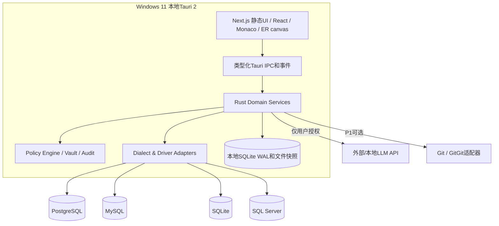
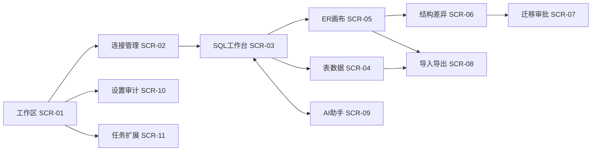
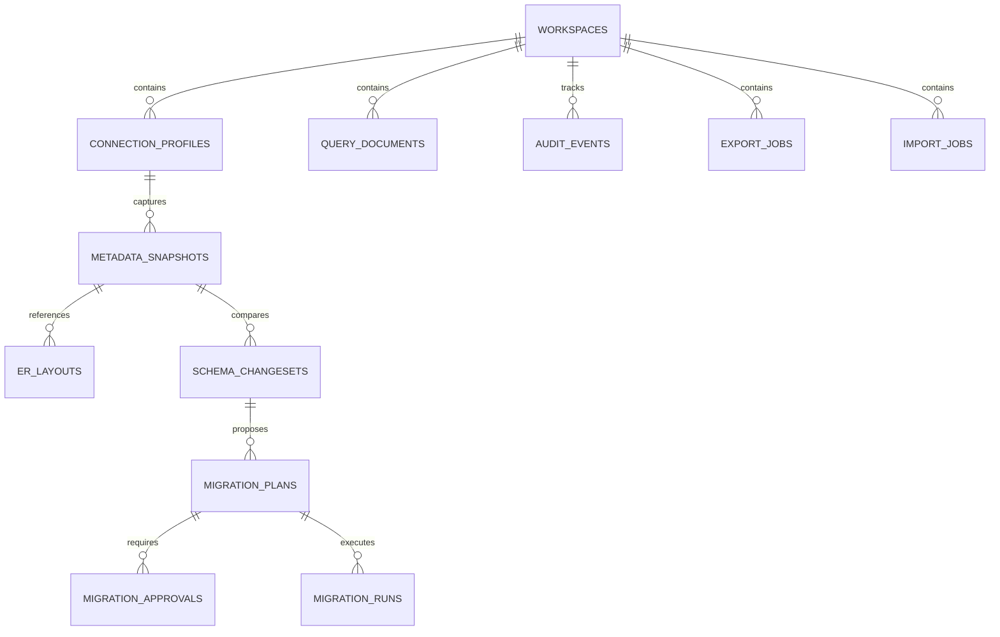

# 02 基本设计书

| 属性 | 值 |
|---|---|
| 产品 | PANTHEON：A5类数据库工作台 / AI原生增强版 |
| 文档版本 | 1.0.0（设计基线，未实施） |
| 基线日期 | 2026-11-03 |
| 语言 | 中文；中日术语对照；导出兼容日文设计书 |
| 状态 | **设计候选基线（待产品负责人和安全负责人正式批准）** |
| 适用工程 | IPA《共通フレーム2013》参考，需求→基本→详细→UT→IT→ST |

## 1. 设计原则与部署形态

架构路线：**Tauri 2桌面壳 + Next.js（静态导出，仅桌面UI）+ TypeScript/React + Rust域服务 + 可插拔DB适配器 + 本地SQLite配置库**。Tauri官方明确要求Next.js使用`output: 'export'`，不支持在Tauri中直接依赖服务器端渲染运行时。因此桌面P0 UI禁用Server Actions、SSR、运行时API routes；所有本机I/O通过Tauri invoke/事件，任何敏感DB动作都在Rust侧验证。**P1独立Web服务端**如有需要另用Next.js服务模式部署，不假设与静态桌面包复用服务端特性。

设计目标：DB账户是实际权限边界、Rust后端是应用安全门禁、UI只负责交互；核心功能离线可用，外部AI/版本系统为可禁用插件。

## 2. 关键技术选型与限制

| 层 | 选型 | 原因 | 边界/替代 |
|---|---|---|---|
| 桌面壳 | Tauri 2 | Rust本地能力、跨平台路线、明确权限控制 | Windows 11 x64首发，CSP和capabilities严格配置 |
| 前端 | Next.js静态导出 + React + TypeScript | 统一现代组件体验；熟悉工具链 | **只能静态export**；不得调用Node服务端API |
| SQL编辑 | Monaco Editor | SQL高亮、诊断、快捷键 | SQL补全依赖自研元数据服务，不将语法高亮当SQL验证 |
| ER可视化 | React Flow/@xyflow（或功能等价MIT许可库）+ 布局引擎 | 节点边与无穷画布，配自研ER约束 | 1000实体需虚拟渲染/分层绘制评估 |
| Rust运行时 | Tokio | DB连接/流式处理/取消 | 禁止阻塞UI主线程 |
| SQL解析 | sqlparser-rs及方言独立规则集 | 对常见SQL作结构风险分析 | 对不支持语法保守处理，高危优先 |
| DB适配 | PG / MySQL / SQLite / SQL Server独立driver适配 | 可以逐引擎测试并隔离差异 | P0须版本矩阵；Oracle P2 |
| 本地持久化 | SQLite WAL + 原子文件存储 | 元数据/任务/快照持久化 | Schema迁移带版本、回滚备份 |
| 密钥存储 | OS Credential Manager / Keychain接口 | 禁止明文文件密钥 | OS库不可用时失败关闭 |
| AI接入 | 可配置兼容API或本地推理端点 | 用户可选供应商/模型 | 默认不共享上下文、AI无执行权 |
| 报告 | CSV+OpenXML XLSX+SVG/PDF导出器 | 匹配日本表定义书工作流 | 流式/分Sheet，模板经许可审查 |
| 自动化测试 | Rust cargo test + Playwright/Tauri E2E + DB矩阵 | 端到端证据与回归 | 测试DB隔离，严禁生产连接 |
| 版本桥 | 本地快照+可插拔Git/GitGit（P1） | 无需依赖外部版本服务 | 对接协议独立于本地存储 |

**版本锁定策略**：依赖采用实施启动时经过CI验证的最新稳定兼容版本，写入Cargo.lock和前端lockfile；本设计不擅自宣称未经构建验证的精确最新版号。商业使用前核对各组件SPDX、字体与模板许可。

## 3. 功能模块与责任分解

| 模块 | Rust域服务 | 前端路由/面板 | 数据存储 | 主要接口 |
|---|---|---|---|---|
| M01 工作区与连接 | WorkspaceService、ConnectionManager | /workspace、/connections | workspaces、profiles | IF-01,02,15,16 |
| M02 SQL执行 | QueryRunner、SqlSafety、TxManager | /sql | documents、history | IF-03,04,05 |
| M03 数据浏览 | MetadataService、RowMutation | /data | 远端DB+草稿 | IF-06,07 |
| M04 ER图 | ERGraphService、LayoutStore | /er | snapshots、layouts、annotations | IF-08,09 |
| M05 差异迁移 | SnapshotService、DiffEngine、MigrationManager | /diff、/migration | snapshots、change_sets、plans、runs | IF-09,10,11 |
| M06 导入导出 | ImportService、ExportService、ReportService | /transfer | job/checkpoints | IF-12,13 |
| M07 AI | AIContextBuilder、ProposalValidator | /ai面板 | ai_requests（元信息） | IF-14,19 |
| M08 安全设置 | VaultService、PolicyEngine、AuditService | /settings | settings、audit | IF-15,17,18 |
| M09 扩展 | CommandRegistry、ExtensionHost | /jobs | extension registry | IF-20 |

## 4. 画面一览与UI原则

主界面为**一窗口、多标签、可伸缩三栏**：左侧对象树，中间SQL/ER/网格，右侧属性/差异/AI建议；底部任务状态和事务/连接状态。工作区与当前连接在每个工作页面顶部固定显示。整体避免大面积装饰和复杂向导。

统一交互：不超过两级菜单才能找到常用SQL/ER/导出功能；运行/停止快捷键可自定义；危险操作专用红色风险区而非日常按钮颜色；确认框清晰展示环境、目标库、受影响对象和恢复性；异步任务进度条支持取消但不得错误宣称已回滚；结果区零数据、无权限、断线与错误具有不同空状态。

## 5. 画面定义（含异常与验证）

| 画面ID | 名称 | 主要构成 | 入口和主流程 | 不可省略的控制 |
| --- | --- | --- | --- | --- |
| SCR-01 | 工作区首页 | 工作区卡片、最近连接、全局搜索、命令面板 | 首次进入/快速切换 | 工作区不存在引导创建 |
| SCR-02 | 连接管理 | 连接参数表单、测试、TLS、凭据、环境标记 | 新建/编辑/连接/错误恢复 | 密码不回显；生产标签固定 |
| SCR-03 | SQL工作台 | 多标签SQL编辑器、对象树、结果网格、执行/停止/事务条 | 查询/事务/执行计划 | 高风险横幅，取消后事务未知锁定 |
| SCR-04 | 表数据浏览 | 数据表网格、筛选器、变更缓存、差异预览 | 查看/插入/更新/删除 | 无PK禁写，批量删除二次确认 |
| SCR-05 | ER画布 | 无限画布、实体/关系、布局、属性侧栏、版本选项 | 逆向生成/建模/联动 | 推断边虚线，物理变更仅生成计划 |
| SCR-06 | Schema Diff | 左/右源、对象差异树、影响、风险、DDL预览 | 比较/计划/审查 | 未知语法高风险，不直接应用 |
| SCR-07 | 迁移审批 | 环境、DDL计划、哈希、备份确认、执行记录 | 预演/审批/执行/结果 | 生产强制输入目标库名确认 |
| SCR-08 | 导入导出 | 来源/目标、字段映射、脱敏、预览、进度 | 导入/导出/报告 | 非授权敏感列阻断 |
| SCR-09 | AI助手 | 提示区、上下文预览、上传同意、建议Diff | 解释/生成/优化/用例建议 | AI按钮与执行按钮分离 |
| SCR-10 | 设置与审计 | 密钥、策略、语言、保留、日志、备份 | 配置/检查/恢复 | 凭据只允许删除和替换不回显 |
| SCR-11 | 任务与扩展 | 批量任务、插件权限、诊断包、CLI | 任务/插件/诊断 | 默认关闭扩展接口 |

## 6. 外部接口设计原则

所有前端向Rust的调用必须使用受控命令名、类型化请求/返回、request_id、取消Token、统一错误枚举、审计上下文；通过事件流输送大量查询结果，不把百万行封装成单次JSON返回。接口版本号为`v1`，序列化以JSON和结构化二进制分批为主。

**接口鉴权/信任边界**：Tauri command本身必须在Rust逐次检查工作区、连接、危险操作策略。前端页面不能直接拿到凭据明文；DB账号的实际权限以目标DB为准。P1 CLI默认关闭，启用时另设本机令牌与显式能力授权。对导出路径做路径归一化和白名单检查。

## 6.1 接口一览

| 接口ID | 方向 | 操作 | 请求形状 | 响应形状 | 风控/备注 |
| --- | --- | --- | --- | --- | --- |
| IF-01 | frontend->Tauri | workspace.create/switch | CreateWorkspaceRequest{path,name} | WorkspaceSummary | 路径校验+原子创建 |
| IF-02 | frontend->Tauri | connection.test | ConnectionProfileRef | ConnectionTestResult{latency,status,error_code} | 10秒超时/取消 |
| IF-03 | frontend->Tauri | query.execute | QueryExecute{connection_id,sql,parameters,mode,request_id} | ResultStreamToken/QuerySummary | SQL安全门禁 |
| IF-04 | frontend->Tauri | query.cancel | CancelRequest{request_id} | CancelAck{state} | 状态未知需查询回执 |
| IF-05 | frontend->Tauri | transaction.change | TxCommand{connection_id,op} | TxStatus | 事务状态机 |
| IF-06 | frontend->Tauri | metadata.load | MetadataQuery{connection_id,object_path} | MetadataPage | 分页/ACL |
| IF-07 | frontend->Tauri | data.change | RowChange{table,key,old_hash,new_values} | ChangeResult{affected,tx_state} | 乐观锁/行数检查 |
| IF-08 | frontend->Tauri | er.generate | ERGenerate{snapshot_id,options} | ERGraphDTO | 无FK推断区分 |
| IF-09 | frontend->Tauri | snapshot.capture | CaptureRequest{connection_id,namespace} | SnapshotRef{hash,objects} | 规范化快照 |
| IF-10 | frontend->Tauri | schema.diff | DiffRequest{left_id,right_id} | DiffSummary/ChangeSet | 危险级别标注 |
| IF-11 | frontend->Tauri | migration.prepare/apply | MigrationPlan{hash,steps,approval} | MigrationRunResult | 仅白名单、审批绑定哈希 |
| IF-12 | frontend->Tauri | export.start | ExportRequest{format,source,masking,output_path} | ExportJobRef | 原子写/流式/进度 |
| IF-13 | frontend->Tauri | import.preview/apply | ImportRequest{mapping,policy,source} | ImportJobRef | 预检/事务策略 |
| IF-14 | frontend->Tauri | ai.preview/request | AIRequest{provider,context,opt_in,budget} | AIProposal{diff,diagnostics} | 上传同意/格式校验 |
| IF-15 | frontend->Tauri | credential.put/delete | CredentialRef+OpaqueSecret | CredentialRef | OS keychain；不可列出明文 |
| IF-16 | Tauri->DB adapter | DbDriver trait | DbRequest/DialectCapabilities | DbResponse/DbError | 最小权限和超时 |
| IF-17 | Tauri->OS | secure credential vault | Keychain alias | SecretHandle | 本地加密储存 |
| IF-18 | Tauri->filesystem | workspace/persistence | atomic write | persisted revision | SQLite WAL+安全路径 |
| IF-19 | Tauri->AI HTTPS | chat completion compatible API | 脱敏后请求 | raw suggestion | 逐次同意+TLS |
| IF-20 | Tauri->version adapter | Git/GitGit bridge (P1) | snapshot+patch | revision ref | 失败不丢本地历史 |

## 7. 逻辑数据模型（本地持久化）

数据库连接的**业务表数据不复制入本地工作区**；只保存经确认的查询历史摘要、结构快照、注释/布局、迁移计划与审计。AI输出建议单独保存元信息，默认不长期缓存原始响应。

稳定ID：UUID用于本地实体，远端DB对象以`engine/connection-id/catalog/schema/object-type/object-name`以及元数据特征建立稳定地址；**重命名无法完全自动推断**，系统仅给候选。快照规范化按方言保留有意义的精度、大小写与默认值。

## 7.1 实体一览

| 表 | 用途 | 字段/类型草案 | 约束/注意 |
| --- | --- | --- | --- |
| workspaces | 工作区 | id UUID PK, name TEXT, root_path TEXT UNIQUE, created_at TIMESTAMP | 工作区根；路径归一 |
| connection_profiles | 连接档案 | id UUID PK, workspace_id FK, engine ENUM, host TEXT, db_name TEXT, tls_json JSON, env ENUM, credential_ref TEXT | 禁存密码 |
| query_documents | SQL草稿 | id UUID PK, workspace_id FK, connection_id FK?, title TEXT, sql TEXT, updated_at, revision BIGINT | SQL可能敏感；可加密 |
| query_history | 执行历史 | id UUID PK, connection_id FK, sql_redacted TEXT, hash TEXT, duration_ms, state ENUM, executed_at | TTL清理和脱敏 |
| metadata_snapshots | 结构快照 | id UUID PK, connection_id FK, dialect TEXT, payload JSON, sha256 TEXT, created_at | 规范化确定性 |
| er_layouts | ER布局 | id UUID PK, snapshot_id FK, viewport JSON, nodes JSON, updated_at | 逻辑与物理解耦 |
| er_annotations | ER注释 | id UUID PK, workspace_id FK, object_stable_id TEXT, logical_name TEXT, tags JSON, review_state ENUM | 不直接改库 |
| schema_changesets | 差异集合 | id UUID PK, left_snapshot FK, right_snapshot FK, change_json JSON, risk ENUM | 不可变快照关联 |
| migration_plans | 迁移计划 | id UUID PK, changeset_id FK, plan_sha256 TEXT, steps JSON, state ENUM, env ENUM | 哈希绑定审批 |
| migration_approvals | 审批记录 | id UUID PK, plan_id FK, plan_sha256 TEXT, approver_id TEXT, approved_at, expiry_at | 计划变更失效 |
| migration_runs | 迁移执行 | id UUID PK, plan_id FK, target_fingerprint TEXT, state ENUM, started_at, finished_at | 逐步记录回执 |
| export_jobs | 导出任务 | id UUID PK, workspace_id FK, format ENUM, request_json JSON, output_path TEXT, status ENUM | 不保存未脱敏行内容 |
| import_jobs | 导入任务 | id UUID PK, workspace_id FK, source_hash TEXT, mapping JSON, status ENUM, error_count INT | 错误行敏感值脱敏 |
| ai_requests | AI请求登记 | id UUID PK, provider_ref TEXT, context_hash TEXT, consent_at, cost_estimate DECIMAL, response_status ENUM | 仅摘要/脱敏元信息 |
| audit_events | 审计事件 | id UUID PK, request_id TEXT, action ENUM, target_hash TEXT, outcome ENUM, occurred_at, details_redacted JSON | 追加写、按保留策略 |
| user_settings | 用户设置 | key TEXT PK, value_json JSON, updated_at | schema+范围校验 |
| job_checkpoints | 作业检查点 | job_id UUID PK, cursor_state JSON, processed_rows BIGINT, updated_at | 导入/导出恢复策略 |
| adapter_registry | 适配器能力 | id TEXT PK, engine TEXT, version TEXT, capability_json JSON | 运行时能力探测 |

## 8. 主要处理方式与状态

- **Query**：DRAFT→VALIDATING→WAITING_CONFIRMATION（可选）→RUNNING→COMPLETED/FAILED/CANCEL_REQUESTED/UNKNOWN；UNKNOWN状态不允许同连接继续写，需重新核验。
- **Migration**：DRAFT→ANALYZED→PREVIEWED→APPROVED→EXECUTING→SUCCEEDED/PARTIAL_FAILED/FAILED/UNKNOWN；plan_hash变化回到DRAFT，审批失效。
- **Export/Import**：NEW→VALIDATING→RUNNING→COMPLETED/FAILED/CANCELLED，失败文件使用临时后缀，不标为成果。
- **AI**：PREVIEWING_CONTEXT→CONSENT_PENDING→REQUESTING→VALIDATING_RESPONSE→PROPOSAL_READY/REJECTED；AI没有`execute`转移。
- **Connection**：DISCONNECTED→CONNECTING→CONNECTED→DEGRADED/UNKNOWN→DISCONNECTED；网络异常不自动视为全部事务回滚。

## 9. 非功能实现映射

| 需求类别 | 设计策略 | 证明方式 |
|---|---|---|
| 性能 | IPC分页/流式、后台线程、虚拟列表/ER局部绘制 | ST-P95、内存峰值、1000表场景 |
| 安全 | OS凭据库、DB最小权限、未知SQL高风险、参数绑定、审计 | 凭据扫描/注入/只读角色/DDL审批专项 |
| 可靠性 | SQLite WAL、原子快照、事务未知态、逐步迁移日志 | 断电、断网、部分DDL成功恢复 |
| 可维护性 | Ports & Adapters、方言能力表、契约测试和错误字典 | 驱动兼容矩阵、静态质量门禁 |
| 本地化 | i18n keys、zh-CN/ja-JP/en-US，逻辑名与物理名分离 | 字符截断/翻译/日本表定义书ST |
| 可追踪 | ID绑定需求/功能/接口/测试/审计 | Excel追踪矩阵及评审记录 |

## 10. 设计审查重点

必须审查不同DB的DDL事务性、认证与TLS矩阵、危险SQL分析边界、ER逻辑态与DB实态隔离、CSV公式注入安全策略、AI敏感数据跨境/供应商合同条款、安装包签名与更新回滚、性能阈值的测试平台与数据集。所有未证实的数据库特性不应写成“必定支持”。
