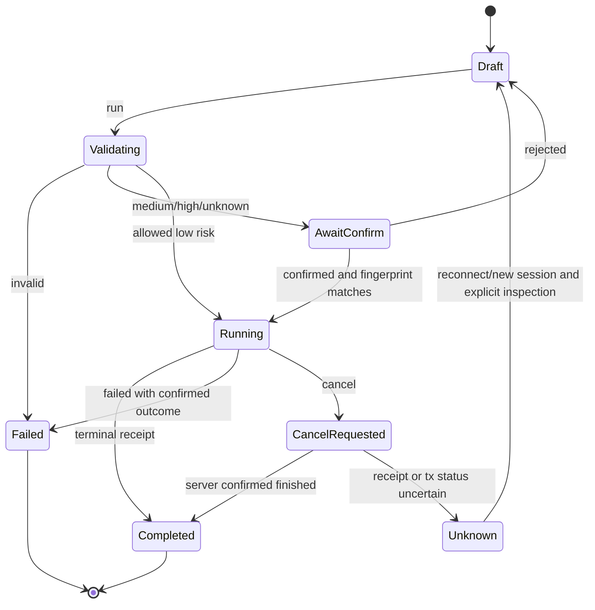
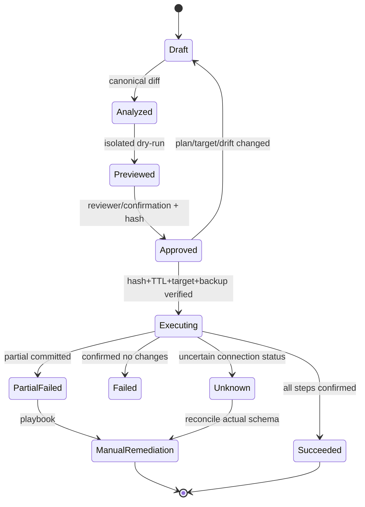
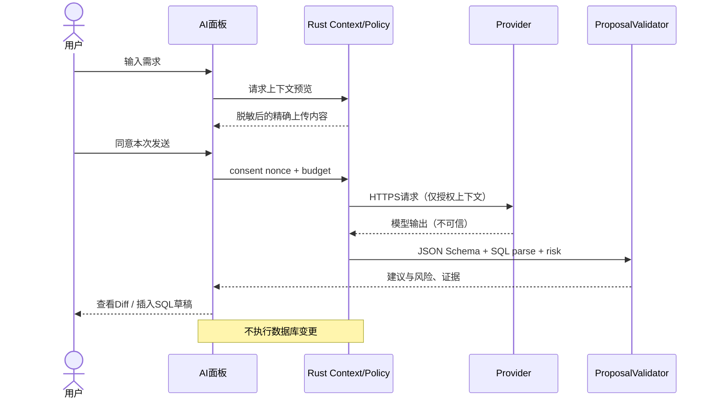

# 03 详细设计书

| 属性 | 值 |
|---|---|
| 产品 | PANTHEON：A5类数据库工作台 / AI原生增强版 |
| 文档版本 | 1.0.0（设计基线，未实施） |
| 基线日期 | 2026-11-03 |
| 语言 | 中文；中日术语对照；导出兼容日文设计书 |
| 状态 | **设计候选基线（待产品负责人和安全负责人正式批准）** |
| 适用工程 | IPA《共通フレーム2013》参考，需求→基本→详细→UT→IT→ST |

## 1. 仓库与模块划分（建议初始骨架）

```text
db-studio/
├── apps/desktop/                   # Next.js静态导出React UI
│   ├── app/{workspace,sql,data,er,diff,transfer,settings}/
│   ├── components/{editor,grid,er,connection,dialogs}/
│   ├── lib/{ipc,contracts,stores,security,i18n}/
│   └── next.config.ts               # output: 'export'
├── apps/desktop/src-tauri/         # Tauri host, capabilities,签名/发布配置
├── crates/
│   ├── db-core/                     # 实体、纯域策略和可测试接口
│   ├── db-workspace/                # SQLite、快照存储、升级
│   ├── db-connectors/               # dialect、DB driver adapters
│   ├── db-query/                    # parser、transaction、result-stream
│   ├── db-schema/                   # metadata、ER、diff、migration
│   ├── db-transfer/                 # import/export/report
│   ├── db-ai/                       # consent、provider、schema-check
│   ├── db-security/                 # vault、audit、policy、redaction
│   └── db-bridge/                   # Tauri typed commands/events
├── tests/{fixtures,contracts,e2e,performance,security}/
├── docs/                            # 本设计文档
└── scripts/                         # CI DB启动、测试数据种子
```

建议公共契约从Rust单一来源生成前端TypeScript类型，CI中检查生成内容未漂移。**不可通过共享不受控的任意SQL执行工具绕过安全门禁**。对外数据库SQL执行是用户主动功能，但每次必须带连接权限和危险级别判断。

## 2. 命令、返回和错误的详细契约

所有IPC请求带：`schema_version: 1`、`request_id: UUID`、`workspace_id: UUID`、`connection_id?: UUID`、`locale`、`client_revision`。所有异步操作返回`request_id`和任务状态，错误用`{code, category, safe_message, retryable, details_redacted}`。不得原样透传驱动异常信息；错误详情由安全脱敏转换。当前工作区和标签的revision不一致时丢弃过期响应，并保留后台任务记录供恢复。

### 2.1 Rust接口抽象（设计级伪接口）

```rust
// 仅为设计接口草案，非可直接编译的生产代码。
trait DbAdapter {
    async fn connect(&self, profile: &SafeConnectionProfile, secret: &SecretHandle)
        -> Result<SessionHandle, DbError>;
    async fn introspect(&self, session: &SessionHandle, path: &ObjectPath)
        -> Result<MetadataPage, DbError>;
    async fn execute_stream(&self, session: &SessionHandle, req: &ValidatedQuery)
        -> Result<ResultStream, DbError>;
    async fn cancel(&self, request_id: RequestId) -> Result<CancelReceipt, DbError>;
    async fn explain(&self, session: &SessionHandle, sql: &ParsedSql, mode: ExplainMode)
        -> Result<PlanResult, DbError>;
    fn capabilities(&self) -> DialectCapabilities;
}

enum TxState { Idle, Active, Committing, RollbackPending, Unknown, Closed }
enum Risk { Low, Medium, High, UnknownHigh }
```

`DialectCapabilities`包含：`supports_transactional_ddl`（具体操作级而非数据库全局布尔值）、`supports_returning`、`supports_cancel`、`supports_read_only_session`、`supports_explain_analyze`、`limit_offset_style`、`identifier_quote_style`、`supports_comments`、`max_bind_parameters`、`ddl_implicit_commit_rules`。运行时探测与版本表共同决定功能是否可用。

### 2.2 前端传输接口（仅示意）

```typescript
type QueryMode = 'selected' | 'current' | 'all';
type Risk = 'low' | 'medium' | 'high' | 'unknown-high';
type TxState = 'idle' | 'active' | 'committing' | 'rollback-pending' | 'unknown';
interface ExecuteQueryRequest {
  schemaVersion: 1;
  requestId: string; workspaceId: string; connectionId: string;
  sql: string; mode: QueryMode;
  parameters: Record<string, string | number | boolean | null>;
  expectedConnectionRevision: number;
  policyConfirmation?: { targetFingerprint: string; planHash?: string; approvedAt: string };
}
interface QueryEvent {
  requestId: string; sequence: number; kind: 'metadata'|'rows'|'progress'|'terminal';
  payload: unknown; txState: TxState;
}
```

**禁止**：前端缓存或返回数据库密码；把一百万行序列化为单次IPC返回；用`eval`解析AI建议；在React代码里直接执行DDL。

## 3. SQL解析、执行与事务状态机

**预处理算法**：先根据连接确定方言→严格词法分析，字符串/注释/标识符按方言保留→AST解析→语句列表→风险分类→能力与远端角色检查→若风险达到中/高则显示上下文确认→产生`ValidatedQuery`→驱动执行→流式返回→审计落盘。

风险规则优先级：已识别DROP/TRUNCATE/用户对象权限变更/批量UPDATE无WHERE/可能执行的EXPLAIN ANALYZE为HIGH；普通INSERT/UPDATE/DELETE为MEDIUM以上；SELECT为LOW仅是UI引导，**SELECT可调用具有副作用的函数，不能保证无副作用**；解析失败、动态SQL、存储过程执行、未知方言一律UNKNOWN_HIGH。风险分类不替代远端只读角色和DB最小权限。



**执行与取消时序**：后端只创建一次request_id映射；事件序列号单调递增；UI遇到旧序列丢弃；取消请求是“请求取消”不是“已回滚”。对于PG事务错误需要正确进入aborted状态；SQL Server与MySQL存在不同的隐式提交与异常语义，需适配层分别处理。

### 3.1 安全Query执行伪代码

```text
run_query(req):
  validate_schema_and_revision(req)
  session = require_open_session(req.connection_id)
  require(req.workspace_id == session.workspace_id)
  classification = parse_and_classify(req.sql, session.dialect)
  if classification.is_unknown: classification.risk = UNKNOWN_HIGH
  if session.tx_state == UNKNOWN and classification.may_write: reject(E-SQL-003)
  if classification.may_write:
     enforce_profile_write_mode_and_server_principle_of_least_privilege()
  if classification.requires_confirmation:
     require_confirmation_bound_to(target_fingerprint, sql_sha256, nonce, expiry)
  audit_start(redact(req), request_id)
  try:
     cursor = session.adapter.execute_stream(req.sql, bind_values(req.parameters))
     for batch in cursor: send_event(request_id, sequence++, batch_limited)
     audit_terminal(outcome, affected_rows, tx_state)
  catch CancellationUncertain:
     mark_session_unknown(); audit_terminal('UNKNOWN'); reject_next_writes()
  finally:
     release_cursor_and_memory(); flush_audit()
```

## 4. 行编辑与并发控制

唯一键判定：只允许远端元数据确认的非空PK，或经验证的稳定唯一键；不允许靠屏幕行号/分页偏移定位行。`RowPatch`必须携带主键值、原值摘要或版本号、变更列清单与类型化参数。构建UPDATE时，标识符通过元数据白名单、值参数绑定；`WHERE PK = :id AND version = :expected_version`；若影响0行，返回`E-DATA-001`，若>1行应强制回滚并报系统异常。无可靠并发字段可使用原值匹配（NULL安全比较，由方言适配），否则提供只读或警告式手动SQL路径。删除/批量写入需可预览SQL及影响估计，实际影响行数以数据库执行回执为准。

## 5. 元数据、ER和快照

采集顺序：`catalog/schema/tables/views → columns/types/defaults → PK/unique/FK/indexes → comments`；权限不足部分返回`partial=true`和缺失清单。ER真实关系仅来自显式FK元数据；名称相似建议为`inferred=true`且默认虚线。逻辑名与标签保存在`er_annotations`，不会被错误写进数据库。

### 5.1 规范化快照与差异算法

```text
capture_metadata(connection):
  meta = read_all_supported_metadata_with_capabilities()
  canonical = dialect_normalize(meta)            # 处理大小写、默认值语义和类型别名
  canonical = stable_sort_by_object_identity(canonical)
  canonical.provenance = {engine, server_version, adapter_version, timestamp}
  digest_input = canonical WITHOUT volatile provenance timestamp
  snapshot_hash = SHA256(serialize_canonical(digest_input))
  persist_atomically(snapshot, snapshot_hash, warnings)

diff(left, right):
  assert compatible canonical schema versions
  match by stable ID, then name; rename suggestions are non-binding
  for matched objects: field-level compare(type/null/default/key/index/comment)
  for unmatched: add/remove and likely rename suggestions
  classify impact and risk for every change; unknown => HIGH
  dependency_toposort(DDL steps); cycles => manual resolution
  output change set with evidence refs to source snapshot paths
```

时间戳/用户操作顺序不会改变结构哈希；**不能把默认值语义差异、索引排序或大小写方言规则“规范化掉”**。因数据库元数据抓取并非全局锁定事务，采集时可选一致性事务/版本标记，发生并发DDL时输出`inconsistent_possible=true`并要求重新采集。

### 5.2 ER布局结构

```json
{
  "schemaVersion": 1,
  "snapshotId": "uuid",
  "viewport": {"x":0,"y":0,"zoom":1.0},
  "nodes": [{"objectId":"pg.public.customer", "x":120,"y":80,"collapsed":false,"labelMode":"both"}],
  "edges": [{"fkId":"fk_orders_customer", "source":"orders","target":"customer","inferred":false}],
  "annotationsRevision": 3
}
```

大图性能：优先在viewport范围内生成节点/边；500ms防抖布局保存；滚动缩放不触发数据库操作；导出SVG在后台worker生成，用户取消不会破坏已存布局。保留节点ID与关系ID，保证点击可读元数据和原始定义。前端事件统一使用`workspace_id/connection_id/snapshot_id`来阻止上下文串扰。

## 6. 迁移DDL计划与审批

每个`MigrationStep`包含`id, dialect, sql, dependency_ids, precondition, risk, irreversible, can_transaction, backup_gate, expected_schema_hash, compensating_action, manual_required`。计划构建时记录快照版本与目标DB指纹；若目标结构在审批后发生漂移，迁移执行失败关闭，提示重新Diff。**预演**仅在已明确指定的隔离测试库执行；生产不自动跑危险DDL做“探测”。



迁移引擎禁止跨数据库方言使用单一回滚承诺。每一步写入结果：`started_at, finished_at, step_hash, tx_pre_state, tx_post_state, affected_object, result_code`；即使进程崩溃，恢复页面明确展示最后确认成功的步骤及待核验部分。DDL逻辑应要求用户通过外部DB备份或快照确认，客户端自身元数据快照**不是备份**。

## 7. 导入、导出、表定义书

| 处理 | 输入 | 算法/校验 | 结果/失败处理 |
|---|---|---|---|
| CSV导出 | 结果流、编码、NULL、脱敏策略 | UTF-8默认、RFC4180、公式注入防护、流式写临时文件 | 成功fsync后原子rename；错误删除临时文件 |
| XLSX导出 | 结果流、样式/模板 | 按行流式写入，Excel每Sheet最多1,048,576行含表头 | 自动分片/多Sheet并显示统计 |
| CSV导入 | 文件编码、字段映射 | 采样→类型检查→整文件校验→按批事务导入 | 每行错误回报且保留源文件 |
| XLSX导入 | sheet、列映射 | 类型/日期/公式处理策略，外部链接不可执行 | 不求值恶意公式、不执行宏 |
| 表定义书 | 快照、逻辑名词典、模板 | 字段/键/索引/FK/备注汇总，按日文模板映射 | 报告包含快照ID、生成时间、版本 |
| ER导出 | 当前快照/画布布局 | 可视区域/全图SVG，字体降级 | 导出不包含连接秘密 |

**文件名与安全**：所有用户选择路径在Rust侧规范化，工作区根路径、软链接与保留目录均需校验；覆盖文件需单独确认。若CSV可在Excel打开，默认对以`=,+,-,@`等危险前缀开头的字符串使用安全前缀或明确的文字单元格规则，确保往返规则在导出报告中可追溯。

## 8. AI助手数据流与输出校验

默认发送最小元数据：表/列名称与类型、必要索引信息、用户选择的SQL；不发送真实业务行、密码、连接串、IP、审计数据。敏感名称可能仍属机密，因此用户可逐次查看即将发送的完整上下文、编辑、取消并选择本地模型。发送前使用策略引擎再次检查是否允许远端AI请求。供应商返回结果须作为不可信数据，经过JSON schema和SQL语法/风险检查，显示`proposed`态；不存在“模型指令→DB直接执行”的工具调用链。



费用预算在发送前使用已知价格和估算tokens做预警；返回真实成本若无法由供应商明确确认，统一标记为“估计”。超时、HTTP 429、无效JSON、提示注入/不可信数据均不影响DB核心工作流。

## 9. 密钥、安全、审计详细约束

- SecretHandle仅在Rust中短期存在，前端绝不获得原始值；加密备份不包含凭据原文，换机必须重授权。
- 不允许用户选择关闭日志脱敏，但允许保留期和日志级别设置。审计需至少包含摘要、动作、时间、目标指纹、环境、请求ID、结果；**不记录密码、SQL绑定敏感值、查询结果原文**。
- OS凭据库不可用时报`E-SEC-001`而不是退化为明文JSON。
- Tauri capabilities按窗口最小化；关闭不必要的shell、文件系统广域、任意网络域访问；远端AI端点允许清单可配置而且经用户明确允许。
- SQL内部元数据查询均使用驱动预处理/参数绑定，动态标识符来自元数据白名单并使用方言引用机制。
- **审计失败策略**：高危写入需要成功持久化`audit_start`才允许执行；低危只读可以在显式降级策略下继续但显示审计异常状态；不能悄悄跳过高危审计。

## 10. 数据库Schema样例（DDL，不等于最终全部表定义）

```sql
PRAGMA foreign_keys = ON;
CREATE TABLE workspaces (
 id TEXT PRIMARY KEY,
 name TEXT NOT NULL CHECK(length(name) BETWEEN 1 AND 100),
 root_path TEXT NOT NULL UNIQUE,
 created_at TEXT NOT NULL
);
CREATE TABLE connection_profiles (
 id TEXT PRIMARY KEY,
 workspace_id TEXT NOT NULL REFERENCES workspaces(id) ON DELETE CASCADE,
 engine TEXT NOT NULL CHECK(engine IN ('postgres','mysql','sqlite','sqlserver')),
 host TEXT, db_name TEXT NOT NULL, tls_json TEXT NOT NULL,
 env TEXT NOT NULL CHECK(env IN ('dev','test','prod')),
 credential_ref TEXT,
 CHECK(credential_ref IS NULL OR length(credential_ref) > 0)
);
CREATE TABLE metadata_snapshots (
 id TEXT PRIMARY KEY, connection_id TEXT NOT NULL REFERENCES connection_profiles(id),
 dialect TEXT NOT NULL, payload TEXT NOT NULL,
 sha256 TEXT NOT NULL CHECK(length(sha256) = 64), created_at TEXT NOT NULL
);
CREATE TABLE migration_plans (
 id TEXT PRIMARY KEY, changeset_id TEXT NOT NULL,
 plan_sha256 TEXT NOT NULL CHECK(length(plan_sha256) = 64),
 steps TEXT NOT NULL, state TEXT NOT NULL,
 env TEXT NOT NULL CHECK(env IN ('dev','test','prod'))
);
CREATE TABLE migration_approvals (
 id TEXT PRIMARY KEY, plan_id TEXT NOT NULL REFERENCES migration_plans(id),
 plan_sha256 TEXT NOT NULL, approver_id TEXT NOT NULL,
 approved_at TEXT NOT NULL, expiry_at TEXT NOT NULL
);
CREATE TABLE audit_events (
 id TEXT PRIMARY KEY, request_id TEXT NOT NULL,
 action TEXT NOT NULL, target_hash TEXT NOT NULL,
 outcome TEXT NOT NULL, occurred_at TEXT NOT NULL,
 details_redacted TEXT NOT NULL
);
CREATE INDEX idx_audit_request_time ON audit_events(request_id, occurred_at);
CREATE INDEX idx_snapshots_by_connection ON metadata_snapshots(connection_id, created_at);
```

所有其他实体参照《02》数据字典与Excel【数据字典】Sheet补齐；实施时由迁移版本`0001_initial.sql`统一维护，与本设计的字段一致性通过自动schema snapshot测试检查。SQL里的`TEXT datetime`必须ISO8601 UTC且由应用层校验；Schema版本升级采用临时备份、迁移事务和回滚策略。

## 11. 错误控制：统一错误码

错误`code`不可随便复用；`retryable`由适配层判定；UI提示必须安全、不泄漏原始SQL内容、服务端目录或秘密。UNKNOWN与PARTIAL_FAILED不能当“失败但已回滚”。

## 11.1 异常字典

| 错误码 | 事件 | 阶段 | 处置策略 | 界面提示 |
| --- | --- | --- | --- | --- |
| E-CONN-001 | 网络不可达 | 连接测试 | 可重试 | 提示网络/代理/DNS，不输出明文连接串 |
| E-CONN-002 | TLS校验失败 | 连接测试 | 不可静默降级 | 显示证书摘要，要求修改安全配置 |
| E-CONN-003 | 认证失败 | 连接测试 | 手工处理 | 不记录密码/令牌 |
| E-CONN-004 | 权限不足 | 元数据/读写 | 不可自动提升 | 建议检查服务端ACL |
| E-SQL-001 | SQL解析未知 | 执行前 | 人工确认且未知高风险 | 标记需人工确认/使用只读账号 |
| E-SQL-002 | 执行超时 | 执行中 | 可取消 | 列明事务未知标记 |
| E-SQL-003 | 取消状态未确认 | 取消中 | 不可强制宣称已取消 | 锁定后续写操作至恢复/重连 |
| E-DATA-001 | 乐观并发冲突 | 行提交 | 刷新后重试 | 原更改保留为草稿 |
| E-DATA-002 | 无稳定唯一键 | 行编辑 | 不可提交 | 引导只读或定义键 |
| E-ER-001 | 元数据关系缺失 | ER生成 | 可部分显示 | 推断关系虚线且标注非真实FK |
| E-DIFF-001 | 快照schema版本不兼容 | 比较 | 需迁移/升级 | 不修改原快照 |
| E-MIG-001 | 审批摘要不匹配 | DDL迁移 | 禁止执行 | 重新计算并审批 |
| E-MIG-002 | DDL部分成功 | 迁移执行 | 按方言补救 | 不得宣称全局回滚 |
| E-EXP-001 | 磁盘空间不足 | 导出 | 可清理重试 | 删除临时文件不覆盖旧文件 |
| E-IMP-001 | 数据类型不匹配 | 导入预览 | 修改映射 | 报告行列定位 |
| E-AI-001 | 未经数据共享同意 | AI请求 | 阻断 | 无外部网络请求 |
| E-AI-002 | AI响应无效 | AI结果校验 | 隔离 | 不能执行候选SQL |
| E-AI-003 | Token预算超额 | 请求前 | 不发送 | 提示调整预算 |
| E-SEC-001 | OS凭据库不可用 | 密钥存取 | 失败关闭 | 不退化到明文配置 |
| E-APP-001 | 工作区SQLite损坏 | 启动/恢复 | 只读/从备份修复 | 不能覆盖原件 |

## 12. 前端组件/数据流详细设计

每个操作按`workspaceId + connectionId + snapshotId + revision`命名作用域，Zustand或等价轻量state store只存UI状态，不放密码。异步请求在切换工作区时使用generation counter验证响应归属；未完成后台作业在任务中心保留引用。SQL编辑器保存为`draft`并每2秒防抖；执行结果仅按游标分页缓存最近若干页，关闭标签释放游标。ER节点点击打开属性侧栏，非相关节点可以弱化但不删除；持久化布局只保存节点坐标和UI标签。全文检索索引在本地工作区维护、支持清理。

### 12.1 确认对话框固定字段

```text
操作类别: UPDATE / DELETE / DDL / AI外传 / 敏感导出
环境: 生产 / 测试 / 开发（不可隐匿）
目标: 主机指纹 + 数据库 + schema + 对象名称
风险: 等级、不可逆情况、可能影响行数（估计）
安全条件: SQL/计划 SHA256、快照ID、备份确认（必要时）
执行者: 本机用户ID、可选外部审批号
确认: 生产操作输入目标DB名称 + 明示确认
```

## 13. 全部功能的实现职责映射

下表不是代码实现情况，而是FR→模块/接口/测试职责映射，作为详细设计覆盖检查的起点。

## 13.1 工作区与连接

| FR | 设计行为/约束 | 核心领域组件 | UT/IT |
| --- | --- | --- | --- |
| FR-01-01 | 工作区隔离连接、SQL文件、ER布局、历史和导出配置；路径可自定义。；验收：新建后列出空工作区；切换不泄漏上个工作区状态。 | WorkspaceService/ConnectionManager | UT-01-01 / IT-01-01 |
| FR-01-02 | 创建PG/MySQL/SQLite/SQL Server连接；保存别名、主机、端口、库、TLS参数，密码分离到系统凭据库。；验收：四种引擎建立有效连接；配置文件不含明文密码。 | WorkspaceService/ConnectionManager | UT-01-02 / IT-01-02 |
| FR-01-03 | 连接测试具超时、重试和错误分类，支持取消；不自动执行任何变更。；验收：超时10秒可中止；错误显示网络/认证/TLS等类别。 | WorkspaceService/ConnectionManager | UT-01-03 / IT-01-03 |
| FR-01-04 | 连接默认只读；写入需手动开启并显示环境、帐号、风险横幅。；验收：只读角色不允许写入；仅切换UI不绕过数据库权限。 | WorkspaceService/ConnectionManager | UT-01-04 / IT-01-04 |
| FR-01-05 | schema/table/view/index/procedure按引擎能力懒加载，支持搜索、刷新、权限不足提示。；验收：1万对象检索不冻结主线程；无权限显示可恢复错误。 | WorkspaceService/ConnectionManager | UT-01-05 / IT-01-05 |
| FR-01-06 | 同时维护多个连接、多标签，标签绑定连接上下文。；验收：两连接执行不会串库；关闭连接提示未保存编辑。 | WorkspaceService/ConnectionManager | UT-01-06 / IT-01-06 |
| FR-01-07 | 开发/测试/生产可自定义环境；生产默认写操作二次确认。；验收：生产写操作显示目标主机/库/影响估计与确认。 | WorkspaceService/ConnectionManager | UT-01-07 / IT-01-07 |

## 13.2 SQL编辑执行

| FR | 设计行为/约束 | 核心领域组件 | UT/IT |
| --- | --- | --- | --- |
| FR-02-01 | 按SQL方言高亮、自动补全、代码折叠、格式化及快捷键。；验收：4种方言高亮/补全；非法SQL不导致编辑器崩溃。 | SqlParser/QueryRunner/TxManager | UT-02-01 / IT-02-01 |
| FR-02-02 | 支持命名参数和驱动绑定；禁止拼接用户输入生成内部SQL。；验收：带引号/特殊字符参数按原值绑定，无额外SQL生效。 | SqlParser/QueryRunner/TxManager | UT-02-02 / IT-02-02 |
| FR-02-03 | 按方言切分语句并保留注释/字符串边界，未知语法进入高风险人工确认。；验收：分号位于字符串/注释内时不错误切分。 | SqlParser/QueryRunner/TxManager | UT-02-03 / IT-02-03 |
| FR-02-04 | 运行当前语句/选中语句/全部；显示耗时、影响行、连接和事务状态。；验收：执行与取消状态可观察；执行日志关联一次请求ID。 | SqlParser/QueryRunner/TxManager | UT-02-04 / IT-02-04 |
| FR-02-05 | 允许取消查询并超时自动关闭游标；取消不假定事务回滚。；验收：取消后标识事务状态不确定时阻断下一写请求。 | SqlParser/QueryRunner/TxManager | UT-02-05 / IT-02-05 |
| FR-02-06 | 支持手动BEGIN/COMMIT/ROLLBACK与默认自动提交选项，事务状态机随驱动对齐。；验收：未提交变更关闭窗口必提示；断连显示未知状态。 | SqlParser/QueryRunner/TxManager | UT-02-06 / IT-02-06 |
| FR-02-07 | 支持目标数据库EXPLAIN适配，区分仅计划与实际执行。；验收：EXPLAIN ANALYZE等可能实际运行的模式显著警示。 | SqlParser/QueryRunner/TxManager | UT-02-07 / IT-02-07 |
| FR-02-08 | 历史仅本地保存可配置保留期，敏感字串脱敏；支持收藏和搜索。；验收：保留期到期清理；不记录凭据、绑定敏感值。 | SqlParser/QueryRunner/TxManager | UT-02-08 / IT-02-08 |
| FR-02-09 | 按游标/键集或驱动支持策略流式分页，大小及超时可配置。；验收：100万行不一次全量驻内存；取消可释放资源。 | SqlParser/QueryRunner/TxManager | UT-02-09 / IT-02-09 |

## 13.3 数据浏览编辑

| FR | 设计行为/约束 | 核心领域组件 | UT/IT |
| --- | --- | --- | --- |
| FR-03-01 | 显示字段、类型、默认值、PK/FK/索引、注释及权限。；验收：PG/MySQL/SQLite/SQLServer字段映射正确；不可用特性标注。 | DataGrid/RowMutation | UT-03-01 / IT-03-01 |
| FR-03-02 | 支持过滤、排序、分页、复制及NULL/二进制显示。；验收：NULL与空字符串视觉区分；二进制按十六进制预览。 | DataGrid/RowMutation | UT-03-02 / IT-03-02 |
| FR-03-03 | 仅对具稳定唯一键的表允许编辑并生成参数化UPDATE。；验收：无唯一键表默认不可编辑；影响行非1则回滚/报冲突。 | DataGrid/RowMutation | UT-03-03 / IT-03-03 |
| FR-03-04 | INSERT/DELETE在写模式下才可用；删除需要确认及行条件检查。；验收：生产删除始终二次确认；无PK时禁止单行删除。 | DataGrid/RowMutation | UT-03-04 / IT-03-04 |
| FR-03-05 | 依据版本列或原值比较做乐观并发，冲突不覆盖他人修改。；验收：并发更新导致影响0行，显示冲突并可刷新比较。 | DataGrid/RowMutation | UT-03-05 / IT-03-05 |
| FR-03-06 | 可视化条件生成经字段白名单及值绑定验证的SQL。；验收：字段名严格从元数据选择；过滤输入不能改变SQL结构。 | DataGrid/RowMutation | UT-03-06 / IT-03-06 |
| FR-03-07 | BLOB/CLOB按大小限制预览，下载须确认并避免内存峰值。；验收：大于阈值只展示摘要；显式导出采用流式处理。 | DataGrid/RowMutation | UT-03-07 / IT-03-07 |
| FR-03-08 | 批量变更先显示行数/差异/风险，提交前可撤销本地草稿。；验收：提交前撤销不发送SQL；提交后不虚称可撤销。 | DataGrid/RowMutation | UT-03-08 / IT-03-08 |

## 13.4 ER建模

| FR | 设计行为/约束 | 核心领域组件 | UT/IT |
| --- | --- | --- | --- |
| FR-04-01 | 从数据库元数据生成实体与FK关系，标记无FK推断为建议。；验收：真实FK为实线；推断关系不误标为真实约束。 | ERGraph/ERLayout | UT-04-01 / IT-04-01 |
| FR-04-02 | 缩放、平移、多选、框选、搜索、对齐、分组与保存位置。；验收：1000表场景满足性能阈值；画布变更有撤销重做。 | ERGraph/ERLayout | UT-04-02 / IT-04-02 |
| FR-04-03 | 字段逻辑名/物理名切换，并允许单独维护逻辑名称映射。；验收：修改逻辑名不会直接修改物理库。 | ERGraph/ERLayout | UT-04-03 / IT-04-03 |
| FR-04-04 | 检测断裂FK、循环、重名、多重边及类型不一致，并给出证据。；验收：每个告警指向对象和可复现结构，不自动改表。 | ERGraph/ERLayout | UT-04-04 / IT-04-04 |
| FR-04-05 | 草拟表/列/关系的结构意图，仅生成可审查DDL，不直接执行。；验收：ER建模更改产生DDL预览和人工批准节点。 | ERGraph/ERLayout | UT-04-05 / IT-04-05 |
| FR-04-06 | 单击节点打开表结构、DDL、数据和引用SQL；按连接隔离。；验收：任何节点点击不跨连接串扰。 | ERGraph/ERLayout | UT-04-06 / IT-04-06 |
| FR-04-07 | 布局按稳定对象ID存JSON，支持SVG/PNG导出及恢复。；验收：布局恢复保留坐标；导出不包含密码。 | ERGraph/ERLayout | UT-04-07 / IT-04-07 |
| FR-04-08 | 展示两版本表/列/关系添加移除和变更标注。；验收：diff区分删除表与重命名不确定性。 | ERGraph/ERLayout | UT-04-08 / IT-04-08 |
| FR-04-09 | 支持业务注释、颜色标签、评审状态，单独存本地设计模型。；验收：本地注释不影响数据库备注，除非显式生成DDL。 | ERGraph/ERLayout | UT-04-09 / IT-04-09 |

## 13.5 结构差异与版本

| FR | 设计行为/约束 | 核心领域组件 | UT/IT |
| --- | --- | --- | --- |
| FR-05-01 | 从元数据生成可重现规范化快照及SHA-256摘要。；验收：重复采集同一结构得到相同摘要；忽略无关顺序噪声。 | SnapshotCanonicalizer/SchemaDiff/MigrationPlanner | UT-05-01 / IT-05-01 |
| FR-05-02 | 比较源/目标、历史/当前、两快照，按对象分类。；验收：新增/删除/修改均列出字段级证据及数据库方言。 | SnapshotCanonicalizer/SchemaDiff/MigrationPlanner | UT-05-02 / IT-05-02 |
| FR-05-03 | DROP/TRUNCATE/ALTER类型收窄/缺索引列入高风险；未知默认高风险。；验收：高风险不得静默通过；AI建议不能降低风险等级。 | SnapshotCanonicalizer/SchemaDiff/MigrationPlanner | UT-05-03 / IT-05-03 |
| FR-05-04 | 生成有序DDL计划、前置条件、影响评估和逆向/补救说明。；验收：依赖排序正确；不可逆操作标注无法自动回滚。 | SnapshotCanonicalizer/SchemaDiff/MigrationPlanner | UT-05-04 / IT-05-04 |
| FR-05-05 | 支持在隔离测试库dry-run并生成日志，不将EXPLAIN等同实际回滚。；验收：预演环境与生产严格区分，输出计划/校验报告。 | SnapshotCanonicalizer/SchemaDiff/MigrationPlanner | UT-05-05 / IT-05-05 |
| FR-05-06 | 执行前记录连接标识、计划哈希、操作者、本地确认及备份确认。；验收：计划被修改后原审批失效；生产强制重新确认。 | SnapshotCanonicalizer/SchemaDiff/MigrationPlanner | UT-05-06 / IT-05-06 |
| FR-05-07 | 本地保存快照与变更集，支持分支标签和时间回看。；验收：删除本地历史需明确确认；不记录秘密。 | SnapshotCanonicalizer/SchemaDiff/MigrationPlanner | UT-05-07 / IT-05-07 |
| FR-05-08 | 可导出文本差异文件并通过可插拔适配器接入Git/GitGit。；验收：未连接任何版本系统仍可独立工作；适配失败不丢本地版本。 | SnapshotCanonicalizer/SchemaDiff/MigrationPlanner | UT-05-08 / IT-05-08 |
| FR-05-09 | 比较基线与当前schema并提醒人工审查；不自动修正。；验收：检测结构漂移显示对象和时间；网络失败不报告为无漂移。 | SnapshotCanonicalizer/SchemaDiff/MigrationPlanner | UT-05-09 / IT-05-09 |

## 13.6 设计书与导入导出

| FR | 设计行为/约束 | 核心领域组件 | UT/IT |
| --- | --- | --- | --- |
| FR-06-01 | 导出日文/中文表定义书，包含逻辑/物理名、字段、索引、关系。；验收：格式字段完整，与结构快照可追踪。 | Exporter/Importer/ReportGenerator | UT-06-01 / IT-06-01 |
| FR-06-02 | 导出SVG/PNG/PDF可视化设计资料及数据字典。；验收：输出关联快照ID；不可用字体有回退。 | Exporter/Importer/ReportGenerator | UT-06-02 / IT-06-02 |
| FR-06-03 | 流式导出UTF-8、可选BOM、分隔符及NULL表达。；验收：保留换行/引号转义；百万行符合内存阈值。 | Exporter/Importer/ReportGenerator | UT-06-03 / IT-06-03 |
| FR-06-04 | 按行分片导出，达到Excel行限制时分Sheet或分文件。；验收：超限显示分片计划，不静默截断。 | Exporter/Importer/ReportGenerator | UT-06-04 / IT-06-04 |
| FR-06-05 | CSV/XLSX预览列映射、类型校验、试运行与错误逐行报告。；验收：导入失败报告行/列/原因；默认事务或批次策略明确。 | Exporter/Importer/ReportGenerator | UT-06-05 / IT-06-05 |
| FR-06-06 | 提供IPA常见表定义书格式与用户自定义模板字段映射。；验收：模板缺字段提示，禁止错误静默导出。 | Exporter/Importer/ReportGenerator | UT-06-06 / IT-06-06 |
| FR-06-07 | 按列脱敏规则预览导出结果，默认不对敏感列明文导出。；验收：无权限或未确认敏感导出时拦截。 | Exporter/Importer/ReportGenerator | UT-06-07 / IT-06-07 |

## 13.7 AI辅助

| FR | 设计行为/约束 | 核心领域组件 | UT/IT |
| --- | --- | --- | --- |
| FR-07-01 | 配置兼容OpenAI风格API/本地模型端点、模型名和能力；Key存OS凭据库。；验收：Key不进入日志/工作区文件；断网不影响核心DB功能。 | AIContext/AIProposalValidator | UT-07-01 / IT-07-01 |
| FR-07-02 | 发送前列出将上传的DDL/SQL/元数据及脱敏影响，逐次同意。；验收：无同意不会发请求；敏感数据默认剔除。 | AIContext/AIProposalValidator | UT-07-02 / IT-07-02 |
| FR-07-03 | 从语言请求与元数据生成SQL候选和来源说明，仅写入草稿。；验收：生成结果不能自动执行；高风险SQL继续受风控。 | AIContext/AIProposalValidator | UT-07-03 / IT-07-03 |
| FR-07-04 | 解释语句、指出可能全表扫描并标识模型推测。；验收：AI不能声称已验证实际执行计划。 | AIContext/AIProposalValidator | UT-07-04 / IT-07-04 |
| FR-07-05 | 提出主外键、规范化、索引候选，标记需人审。；验收：建议不会改变真实FK或表。 | AIContext/AIProposalValidator | UT-07-05 / IT-07-05 |
| FR-07-06 | 使用脱敏/合成结构生成SQL测试草案，避免真实敏感值外发。；验收：输出标记为建议且需人工审核。 | AIContext/AIProposalValidator | UT-07-06 / IT-07-06 |
| FR-07-07 | AI输出经过JSON schema、SQL解析及安全分级后进入界面。；验收：无效JSON与未知SQL被隔离，不直接进入执行通道。 | AIContext/AIProposalValidator | UT-07-07 / IT-07-07 |
| FR-07-08 | 支持每次请求预算阈值、超时及供应商速率限制。；验收：超预算前阻断；使用量估算不当作账单事实。 | AIContext/AIProposalValidator | UT-07-08 / IT-07-08 |
| FR-07-09 | 工作区/数据库上下文按请求指定并防止跨租户/跨库串数据。；验收：切换工作区期间已发请求响应不得污染当前界面。 | AIContext/AIProposalValidator | UT-07-09 / IT-07-09 |

## 13.8 安全审计与设置

| FR | 设计行为/约束 | 核心领域组件 | UT/IT |
| --- | --- | --- | --- |
| FR-08-01 | 数据库与AI密钥仅通过OS keychain存取；可撤销/清除。；验收：导出包/日志/剪贴板默认无密钥；删除后凭据不可取。 | CredentialVault/AuditLogger/PolicyEngine | UT-08-01 / IT-08-01 |
| FR-08-02 | SQL分类、连接只读角色、DDL/DML确认组成分层防护。；验收：误分类时服务端权限仍能阻止写入；禁止无确认批量DROP。 | CredentialVault/AuditLogger/PolicyEngine | UT-08-02 / IT-08-02 |
| FR-08-03 | 日志/AI/导出/错误信息应用敏感字段标记和脱敏策略。；验收：密钥与数据库密码在全部日志样本中不可恢复。 | CredentialVault/AuditLogger/PolicyEngine | UT-08-03 / IT-08-03 |
| FR-08-04 | 记录操作者、时间、目标、动作、风险、结果、摘要及关联ID。；验收：审计无明文敏感数据；时钟与事件顺序可核验。 | CredentialVault/AuditLogger/PolicyEngine | UT-08-04 / IT-08-04 |
| FR-08-05 | 配置超时/行限制/工作区/主题/语言/保留期限等，变更生效可见。；验收：默认值安全；非法设置不使应用无法启动。 | CredentialVault/AuditLogger/PolicyEngine | UT-08-05 / IT-08-05 |
| FR-08-06 | 展示远端数据库当前账号权限与只读建议，不代替服务器ACL。；验收：权限检查失败视为未知，不声称有权限。 | CredentialVault/AuditLogger/PolicyEngine | UT-08-06 / IT-08-06 |
| FR-08-07 | 工作区元数据可加密备份，支持预览和版本兼容校验。；验收：坏包/错误密钥不会覆盖原工作区。 | CredentialVault/AuditLogger/PolicyEngine | UT-08-07 / IT-08-07 |
| FR-08-08 | 桌面离线完成主要SQL/ER/导出功能，升级包验证签名和来源。；验收：离线无AI仍可操作；失败升级可恢复原版本。 | CredentialVault/AuditLogger/PolicyEngine | UT-08-08 / IT-08-08 |

## 13.9 扩展与自动化

| FR | 设计行为/约束 | 核心领域组件 | UT/IT |
| --- | --- | --- | --- |
| FR-09-01 | 键盘驱动SQL、连接、ER、导出，冲突可检测。；验收：快捷键冲突提示不覆盖核心命令。 | CommandBus/ExtensionHost | UT-09-01 / IT-09-01 |
| FR-09-02 | 以显式配置执行批量导出/快照/比较，具进度与取消。；验收：取消写清部分完成情况，失败可重试幂等任务。 | CommandBus/ExtensionHost | UT-09-02 / IT-09-02 |
| FR-09-03 | 插件通过显式能力清单调用限定API，无默认数据库密钥权限。；验收：未授权插件无法读取凭据、执行SQL。 | CommandBus/ExtensionHost | UT-09-03 / IT-09-03 |
| FR-09-04 | 提供版本化的JSON-RPC/CLI可选接口，默认关闭。；验收：关闭时端口不可访问；启用需本地令牌。 | CommandBus/ExtensionHost | UT-09-04 / IT-09-04 |
| FR-09-05 | 简体中文、日语、英语支持；中日逻辑名规范。；验收：三语关键流程可切换；无翻译回退不丢控件。 | CommandBus/ExtensionHost | UT-09-05 / IT-09-05 |
| FR-09-06 | 跨SQL、对象、快照、注释全文检索并过滤连接。；验收：结果指向所属工作区/连接，不混淆。 | CommandBus/ExtensionHost | UT-09-06 / IT-09-06 |
| FR-09-07 | 用户同意后打包匿名化错误、性能指标与版本信息。；验收：诊断包不包含凭据、原始查询结果。 | CommandBus/ExtensionHost | UT-09-07 / IT-09-07 |

## 14. API/DB错误下的资源释放策略

连接超时：断开半开连接并取消重试定时器；SQL取消：关闭游标、保留事务未知状态；大对象流中断：释放文件与游标；CSV/Excel错误：关闭文件句柄、删除`.partial`；AI超时：标记请求失败，不应用建议；版本GitGit失败：本地快照成功并将桥接标记为待重试；工作区损坏：只读隔离并让用户选择备份恢复，不覆盖原文件。

## 15. 代码评审、提交与验收条件

必须具备：明确接口/错误类型、元数据与风险判断单测、方言契约测试、Tauri能力白名单检查、密钥与日志扫描、AI无同意零网络请求测试、提交历史包含设计变更与对应测试设计变更。禁止只凭界面能显示就宣布能力已支持。验收环境以CI与ST报告中的实测版本为准。
