# 08 安全与AI治理设计书

| 属性 | 值 |
|---|---|
| 产品 | PANTHEON：A5类数据库工作台 / AI原生增强版 |
| 文档版本 | 1.0.0（设计基线，未实施） |
| 基线日期 | 2026-11-03 |
| 语言 | 中文；中日术语对照；导出兼容日文设计书 |
| 状态 | **设计候选基线（待产品负责人和安全负责人正式批准）** |
| 适用工程 | IPA《共通フレーム2013》参考，需求→基本→详细→UT→IT→ST |

## 1. 资产分类与威胁边界

| 资产 | 机密等级 | 主要威胁 | 控制方式 |
|---|---|---|---|
| 数据库密码/AI Token | 极高 | 文件/日志/插件窃取 | OS凭据库+最小权限+不回显 |
| 生产数据库数据 | 高/极高 | 误删、批量写、越权 | 服务端DB最小权限+审批+审计 |
| Schema/ER/业务逻辑名 | 高 | 未授权模型上传/导出 | 逐次授权+脱敏+本地优先 |
| SQL历史/执行计划 | 高 | 连接串/业务值泄漏 | TTL、脱敏、可清除 |
| 更新包/插件 | 高 | 供应链攻击 | 来源与签名校验/能力白名单 |
| 日志/诊断包 | 中-高 | 间接秘密泄漏 | 采集前预览、关键字段强制脱敏 |

## 2. 数据流分区

```mermaid
flowchart LR
 subgraph Trust1[本机可信边界]
  UI[静态UI: 无秘密]
  R[Rust策略/域层]
  K[(OS凭据库)]
  L[(工作区SQLite/快照)]
  UI -->|类型化IPC| R
  R <--> K
  R <--> L
 end
 R -->|用户主动连接+数据库身份| DB[(远端数据库)]
 R -.->|脱敏+逐次同意| AI[AI服务商/本地模型]
 R -.->|P1授予能力| PL[扩展插件/版本桥]
```

边界A：WebView UI不是可信安全执行层，所有敏感检查都在Rust侧；边界B：Rust与远端DB之间仍受DB账户权限限制；边界C：对AI远端请求属于机密外传，必须明确列示内容并同意；边界D：插件是低信任，不能默认拿到本地凭据或DB执行能力。

## 3. STRIDE风险与防护

| STRIDE | 威胁场景 | 缓解与验证 |
|---|---|---|
| S 伪装 | 伪造连接配置或目标DB | TLS验证+目标指纹+生产确认；ST验目标变更 |
| T 篡改 | 修改已审批计划 | plan_sha256+DB指纹+短时有效期；UT哈希失效 |
| R 抗抵赖 | 误执行后无证据 | 审计启动/结束双记录，UTC时钟+request_id |
| I 信息泄露 | 日志/AI/导出泄漏 | 脱敏扫描+默认拒绝AI外传+CSV公式注入防护 |
| D 拒绝服务 | 大结果占满内存 | 游标分页/行限制/时间与内存上限 |
| E 权限提升 | 插件/SQL解析绕过 | Tauri capabilities/Rust权限/远端只读role |

## 4. 安全门禁（必须以服务端权限为最终边界）

1. **连接建立**：TLS参数严格检查，生产只读默认，角色权限探测失败视为未知而非可写。
2. **SQL分类**：AST按方言解析，多语句逐条审查；未知风险默认高，解析器不能证明SELECT无副作用。
3. **查询执行**：工作区与连接绑定、请求摘要、防重放nonce/确认过期、DB最小权限。
4. **行编辑**：PK/唯一键约束、乐观锁、受影响行数检查；未确认不写。
5. **迁移DDL**：计划哈希+目标指纹+环境+审批有效期+外部备份确认；断线后状态未知不能假装回滚。
6. **AI**：无同意0网络；上下文预览、默认不含业务数据、模型输出隔离；不暴露可写DB工具。
7. **文件与插件**：路径规范化、CSP、最小Tauri能力、默认禁用扩展、供应链校验。
8. **敏感导出**：列级脱敏和确认，公式注入防护；覆盖写入经用户确认。

## 5. AI治理设计

AI提供商可通过用户配置的端点接入，但只有本地模型可在默认完全离线策略下处理Schema。远端AI请求应保存最低限度的同意记录（授权者、时间、上下文哈希、供应商、目的、预算、结果代码），原始上下文默认不留本地审计明文。用户可撤销密钥与清理历史。AI模型可能输出错误SQL、虚构索引、忽略方言，因此展示“未验证建议”，只有可核验来源的Schema信息才标“已采集事实”。

**AI风控状态链**：上下文选择→敏感字段掩码→精确内容预览→同意nonce→费用预算→HTTPS调用→结构校验→SQL解析→风险提示→人工草稿，不存在自动执行。对AI输出不可采用字符串清洗后直接作为系统指令；其文本和JSON永远属于数据。

## 6. 数据保护与地区/企业政策

面向日本客户时，需按客户合同、内部信息管理、个人信息保护法（APPI）与跨境委托要求另行确认使用远端AI的合法性。此设计不宣称默认满足全部司法辖区合规。支持管理员策略文件禁用远端AI；普通用户不能绕过不可变企业策略。需要网络代理时，不能因代理/证书故障自动关闭TLS验证。

## 7. 安全测试落地映射

| 风险 | 测试 | 必要证据 |
|---|---|---|
| SQL参数注入 | UT-X-001/IT-DB各WRITE/ST-X-001 | 数据库实际对象未改变/语句记录 |
| AI零外传 | UT-X-011/ST-X-003 | 模拟服务/抓包计数0 |
| 计划审批篡改 | UT-X-013/ST-X-007 | SHA256前后+拒绝回执 |
| 秘密泄漏 | UT-X-015/UT-X-016/ST-X-002 | 全目录/日志/包扫描 |
| SQL取消未知 | UT-X-003/IT-X-001 | 会话状态UNKNOWN、拒绝写入 |
| 版本与恢复 | IT-X-011/ST-X-010 | WAL恢复/旧版可启动证据 |
| 插件越权 | UT-X-019/IT-X-013 | 权限拒绝和审计日志 |
| CSV公式注入 | UT-X-006/导入导出IT | Excel或等价解析工具检查 |

## 8. 安全审核清单

- [ ] Tauri配置仅允许必要窗口/命令/文件操作；CSP与更新源限制经过审核
- [ ] DB/AI秘密原文从不进入UI store、日志、诊断包、导出包
- [ ] 连接只读模式与服务器权限双重测试（不存在UI绕过）
- [ ] 未知SQL、存储过程、副作用SELECT的边界文案清楚
- [ ] AI无授权时模拟网络0次调用，输出JSON不可信校验健全
- [ ] 高危DDL计划哈希与目标指纹绑定、失效/断线/部分成功路径通过
- [ ] 导出CSV公式保护和文件路径穿越测试通过
- [ ] 依赖安全扫描、许可审查、安装更新签名校验通过
