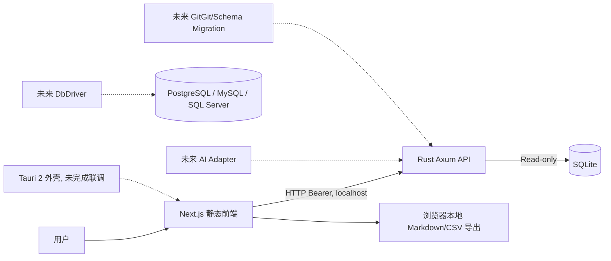

# PANTHEON 架构与部署视图

信任边界：WebView/浏览器不直接访问 DB 文件；数据库路径仅服务端配置；API 的读访问受 Bearer Token 限制；数据库只读属性由 SQLite 连接确保。未来执行 DDL 必须引入专用权限、变更审核、审计及事前备份策略，禁止直接复用只读 API。

## 技术基线

- Next.js `16.4.4`；React `19.x`；TypeScript `5.9.x`。
- Tauri 2 API 目标 `2.12.x`，桌面外壳待构建验证。
- Rust stable + Axum `0.8` + rusqlite `0.37`，具体解析版本取决于 Cargo.lock（本包因无法执行 cargo，未生成锁文件）。
- Web UI 依赖的 lockfile 也尚未生成（网络安装未完成）。正式 CI 应生成、审计并提交锁文件后使用锁定安装。
